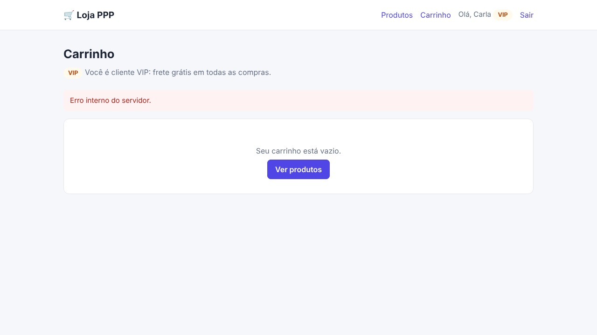
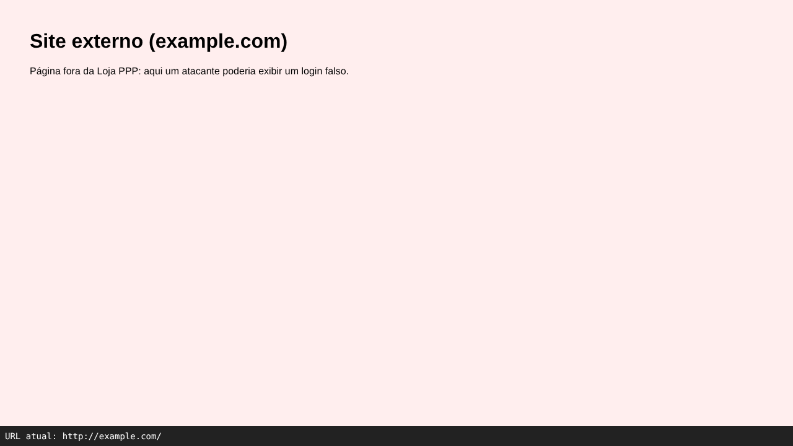

# 🐞 Report de Bugs — Loja PPP

> Relatórios de incidente estruturados conforme a **ISO/IEC/IEEE 29119-3:2021** (*Incident Report*). Os defeitos foram encontrados na execução dos [Casos de Teste Web](02-casos-de-teste-web.md) e [API](03-casos-de-teste-api.md) e reproduzidos com a aplicação recém-iniciada, com evidências salvas em [`evidencias/bugs/`](evidencias/bugs/).

⬅️ [Índice da documentação de QA](README.md)

---

## 1. Visão geral

### 1.1 Identificação do documento

| Item | Valor |
|---|---|
| **Identificador** | `RI-LOJAPPP-001` |
| **Título** | Relatórios de Incidente — Loja PPP |
| **Versão** | 1.1 (27/11/2026: inclusão do BUG-008, encontrado nos testes de performance) |
| **Data** | 26/11/2026 |
| **Autora** | Lilyan Lacerda (QA) |
| **Item de teste** | IT-01 API REST e IT-02 Site Web, versão 1.0.0, commit `f134da6` |

### 1.2 Ambiente de execução

| Item | Valor |
|---|---|
| Aplicação | `npm start` em http://localhost:3030, banco em memória reiniciado antes da reprodução |
| Runtime | Node.js 22.23.5 · MongoDB 8.2.6 (`mongodb-memory-server`) |
| SO | Linux (kernel 6.18) |
| Navegador | Chromium (Playwright), janela de 1280 × 720 |
| Ferramentas | `fetch` do Node (scripts de reprodução), Playwright (capturas de tela), consulta direta ao MongoDB para conferência |

### 1.3 Painel

| ID | Título | Severidade | Prioridade | Status | Casos que revelaram |
|---|---|---|---|---|---|
| [BUG-001](#bug-001--checkouts-simultâneos-gravam-pedidos-duplicados-baixam-estoque-a-mais-e-retornam-500) | Checkouts simultâneos gravam pedidos duplicados, baixam estoque a mais e retornam 500 | 🔴 Crítica | P1 | Aberto | CT-API-CHK-15, CT-WEB-CHK-11 |
| [BUG-002](#bug-002--redirecionamento-após-o-login-leva-para-site-externo-open-redirect) | Redirecionamento após o login leva para site externo (*open redirect*) | 🟡 Média | P2 | Aberto | CT-WEB-LOG-09 |
| [BUG-003](#bug-003--corpo-de-requisição-grande-demais-retorna-500-em-vez-de-413) | Corpo de requisição grande demais retorna 500 em vez de 413 | 🟡 Média | P3 | Aberto | CT-API-SEC-09 |
| [BUG-004](#bug-004--quantidade-do-carrinho-aceita-booleano-texto-e-null-convertendo-o-tipo) | Quantidade do carrinho aceita booleano, texto e `null`, convertendo o tipo | 🟡 Média | P3 | Aberto | CT-API-CAR-08 |
| [BUG-005](#bug-005--cadastro-aceita-senha-formada-só-por-espaços) | Cadastro aceita senha formada só por espaços | 🟢 Baixa | P3 | Em análise (PO) | CT-API-AUTH-10, CT-WEB-CAD-10 |
| [BUG-006](#bug-006--prévia-do-checkout-cobra-frete-com-o-carrinho-vazio) | Prévia do checkout cobra frete com o carrinho vazio | 🟢 Baixa | P3 | Em análise (PO) | CT-API-CHK-16 |
| [BUG-007](#bug-007--esquema-de-autenticação-bearer-em-minúsculas-é-recusado) | Esquema de autenticação `bearer` em minúsculas é recusado | 🟢 Baixa | P3 | Aberto | CT-API-SEC-06 |
| [BUG-008](#bug-008--login-sob-carga-ultrapassa-a-meta-de-tempo-e-deixa-toda-a-api-lenta) | Login sob carga ultrapassa a meta de tempo e deixa toda a API lenta | 🟡 Média | P2 | Aberto | PERF-02 |

**Totais:** 8 defeitos · 🔴 Crítica 1 · 🟠 Alta 0 · 🟡 Média 4 · 🟢 Baixa 3.

| Funcionalidade | Defeitos |
|---|---|
| Finalização de compra | BUG-001, BUG-006 |
| Login e autenticação | BUG-002, BUG-007, BUG-008 |
| Carrinho | BUG-004 |
| Cadastro | BUG-005 |
| Geral (tratamento de erros) | BUG-003 |

> **Severidade e prioridade** seguem as definições do [Plano de Testes, seção 4](01-plano-de-testes.md#4-comunicação-do-teste). **Status "Em análise (PO)"**: o comportamento esperado não está explícito nos requisitos e depende de decisão do Product Owner.

---

## 2. Relatórios de incidente

### BUG-001 — Checkouts simultâneos gravam pedidos duplicados, baixam estoque a mais e retornam 500

| Campo | Conteúdo |
|---|---|
| **Severidade / Prioridade** | 🔴 **Crítica** / **P1** |
| **Status** | Aberto |
| **Data / Autora** | 26/11/2026 · Lilyan Lacerda |
| **Item e versão** | IT-01 API REST e IT-02 Site Web · 1.0.0 (`f134da6`) |
| **Endpoint / página** | `POST /api/checkout` · `/carrinho` |
| **Casos de teste** | CT-API-CHK-15 (❌), CT-WEB-CHK-11 passo 3 (❌) |
| **Requisitos / riscos** | RF06, RN02 · RP03 (exposição 6) · ISO 25010: Adequação funcional (correção), Confiabilidade (tolerância a falhas) |
| **Reprodutibilidade** | API com 5 requisições paralelas: 100% (5/5 execuções). Web com 2 abas: intermitente (1 em 2 tentativas na última rodada) |

**Descrição**

Quando o mesmo carrinho é finalizado por mais de uma requisição ao mesmo tempo (duplo envio, duas abas ou nova tentativa automática do cliente HTTP), a API grava **um pedido para cada requisição** e baixa o estoque de cada uma. Ao cliente, porém, **só uma requisição retorna sucesso**; as outras retornam **500 "Erro interno do servidor."**. O total gasto do cliente registra apenas uma compra. Resultado: pedidos "fantasmas" que o cliente não vê, estoque inconsistente com as vendas e status VIP calculado sobre um valor diferente do que foi gravado.

**Pré-condições**
- Aplicação recém-iniciada (Teclado Mecânico com estoque 10).
- Cliente novo autenticado, com 1 Teclado Mecânico no carrinho.

**Passos para reproduzir (API)**
1. `POST /api/cart/items` · `{ "productId": "<id do Teclado>", "quantity": 1 }`.
2. Disparar **5** `POST /api/checkout` · `{ "paymentMethod": "cash" }` em paralelo (ex.: `Promise.all`).
3. `GET /api/products/<id do Teclado>` e `GET /api/users/me`.

**Passos para reproduzir (Web)**
1. Entrar como Carla e adicionar 1 Mouse Sem Fio ao carrinho.
2. Abrir `/carrinho` em **duas abas**.
3. Clicar em **Finalizar compra** nas duas abas quase ao mesmo tempo.
4. Voltar à vitrine e conferir o estoque do Mouse.

| Resultado esperado | Resultado obtido |
|---|---|
| Exatamente **1** resposta **201**; as demais **422** "O carrinho está vazio." | **1** resposta **201** e **4** respostas **500** "Erro interno do servidor." |
| **1** pedido gravado | **5** pedidos gravados no banco (`orders`), todos com total R$ 245,00 |
| Estoque do Teclado: 10 → **9** | Estoque do Teclado: 10 → **5** |
| `totalSpent` do cliente coerente com os pedidos gravados | `totalSpent` = R$ 245,00 (1 compra), embora existam 5 pedidos |
| Web: uma aba exibe o pedido e a outra informa carrinho vazio | Web: uma aba exibe o pedido e a outra mostra "Erro interno do servidor."; o estoque do Mouse caiu de **4 para 2** com **1** unidade comprada |

**Evidências**
- [BUG-001-log.txt](evidencias/bugs/BUG-001-log.txt): requisições, respostas e consulta ao MongoDB com os 5 pedidos.
- [BUG-001-server-log.txt](evidencias/bugs/BUG-001-server-log.txt): erro no servidor `VersionError: No matching document found for id ... modifiedPaths "items"`.
- [BUG-001-web-aba-1.png](evidencias/bugs/BUG-001-web-aba-1.png) e [BUG-001-web-aba-2.png](evidencias/bugs/BUG-001-web-aba-2.png): uma aba com o pedido confirmado e a outra com o erro.

**Análise de causa provável (caixa-cinza)**

Em `src/services/checkoutService.js`, cada requisição lê o mesmo carrinho e executa, sem transação:
1. baixa do estoque com `Product.findOneAndUpdate` (linha 53), que é atômica **por requisição** e por isso aceita todas enquanto houver estoque;
2. `user.save()` (linha 72), em que a última escrita vence, por isso o `totalSpent` conta uma compra só;
3. `Order.create(...)` (linha 74), que grava um pedido para cada requisição;
4. `cart.save()` (linha 90), onde o controle de versão do Mongoose rejeita todas as gravações menos a primeira (`VersionError`) e gera o erro 500.

Como o erro acontece **depois** da baixa de estoque e da criação do pedido, e não há desfazimento, os efeitos ficam gravados.

**Sugestão de correção**
- "Reservar" o carrinho no início do checkout com uma operação atômica, por exemplo `Cart.findOneAndUpdate({ user, 'items.0': { $exists: true } }, { $set: { items: [] } })`, e só seguir se a requisição conseguiu a reserva; as demais recebem 422 "O carrinho está vazio.".
- Alternativa: transação do MongoDB (exige *replica set*) envolvendo estoque, pedido, cliente e carrinho.
- Atualizar `totalSpent` com `$inc` em vez de `user.save()`.
- No site, manter o botão desabilitado após o clique (já existe) e considerar uma chave de idempotência por checkout.

---

### BUG-002 — Redirecionamento após o login leva para site externo (*open redirect*)

| Campo | Conteúdo |
|---|---|
| **Severidade / Prioridade** | 🟡 **Média** / **P2** |
| **Status** | Aberto |
| **Data / Autora** | 26/11/2026 · Lilyan Lacerda |
| **Item e versão** | IT-02 Site Web · 1.0.0 (`f134da6`) |
| **Página** | `/login?voltar=...` |
| **Caso de teste** | CT-WEB-LOG-09 (❌ na variação c) |
| **Requisitos / riscos** | RF03 · RP06 (exposição 4) · ISO 25010: Segurança (integridade) · OWASP: *Unvalidated Redirects and Forwards* |
| **Reprodutibilidade** | 100% |

**Descrição**

O parâmetro `voltar` da página de login aceita o valor `/\example.com`. Depois de um login **legítimo**, o navegador leva o cliente para `http://example.com/`. Um atacante pode enviar um link verdadeiro da Loja PPP que, após o login, leva a vítima para uma página falsa (por exemplo, "senha incorreta, digite novamente"), facilitando *phishing*. As variações `https://example.com` e `//example.com` **são bloqueadas corretamente**; só a barra invertida escapa da validação.

**Pré-condições**
- Visitante não logado.

**Passos para reproduzir**
1. Acessar `http://localhost:3030/login?voltar=/%5Cexample.com` (`%5C` é a barra invertida `\`).
2. Entrar com `ana@email.com` / `123456`.

| Resultado esperado | Resultado obtido |
|---|---|
| Cliente levado para `/` da Loja PPP | Cliente levado para **`http://example.com/`** |

**Evidências**
- [BUG-002-1-login-com-parametro.png](evidencias/bugs/BUG-002-1-login-com-parametro.png): página de login aberta com o parâmetro.
- [BUG-002-2-redirecionado-site-externo.png](evidencias/bugs/BUG-002-2-redirecionado-site-externo.png): página carregada em `example.com` após o login. O conteúdo foi simulado, porque o ambiente de teste não tem acesso à internet; a URL é a real.

**Análise de causa provável**

`public/login.html`, linha 58, valida o destino com `back.startsWith('/') && !back.startsWith('//')`. Os navegadores tratam `\` como `/` em URLs especiais, então `/\example.com` vira `//example.com`, uma URL relativa ao protocolo que aponta para outro domínio.

**Sugestão de correção**

Resolver a URL e comparar a origem: `const url = new URL(back, location.origin); if (url.origin === location.origin) location.href = url.pathname + url.search; else location.href = '/';`. Outra opção é aceitar apenas uma lista fixa de destinos (`/`, `/carrinho`).

---

### BUG-003 — Corpo de requisição grande demais retorna 500 em vez de 413

| Campo | Conteúdo |
|---|---|
| **Severidade / Prioridade** | 🟡 **Média** / **P3** |
| **Status** | Aberto |
| **Data / Autora** | 26/11/2026 · Lilyan Lacerda |
| **Item e versão** | IT-01 API REST · 1.0.0 (`f134da6`) |
| **Endpoint** | Qualquer rota com corpo JSON (reproduzido em `POST /api/auth/login`) |
| **Caso de teste** | CT-API-SEC-09 (❌) |
| **Requisitos / riscos** | RNF01 · RP07 (exposição 4) · ISO 25010: Confiabilidade (maturidade) |
| **Reprodutibilidade** | 100% |

**Descrição**

Um corpo JSON acima do limite padrão do Express (100 KB) é recusado pelo servidor, mas a resposta é **500 "Erro interno do servidor."** e o erro aparece no log como falha inesperada. Um erro causado pelo cliente deveria retornar **413 Payload Too Large**. O 500 confunde o consumidor da API, polui o monitoramento com falsos alarmes de erro interno e diverge da tabela de códigos de resposta do projeto.

**Passos para reproduzir**
1. `POST /api/auth/login` com `Content-Type: application/json` e o corpo `{ "email": "<200.000 letras 'a'>", "password": "x" }` (~200 KB).

| Resultado esperado | Resultado obtido |
|---|---|
| **413** com `{ "error": "<mensagem>" }` | **500** · `{ "error": "Erro interno do servidor." }` |

**Evidências**
- [BUG-003-log.txt](evidencias/bugs/BUG-003-log.txt): requisição e resposta.
- [BUG-003-server-log.txt](evidencias/bugs/BUG-003-server-log.txt): `PayloadTooLargeError: request entity too large` registrado como erro não tratado.

**Análise de causa provável**

`src/middleware/errorHandler.js` trata `entity.parse.failed` (linha 8), mas não `entity.too.large`. O erro cai no tratamento genérico (linha 15), que responde 500.

**Sugestão de correção**

No `errorHandler`, responder com `err.status` quando `err.type === 'entity.too.large'` (413) ou, de forma geral, usar `err.status` / `err.statusCode` dos erros do `body-parser` quando estiver na faixa 4xx. Documentar o 413 no Swagger.

---

### BUG-004 — Quantidade do carrinho aceita booleano, texto e `null`, convertendo o tipo

| Campo | Conteúdo |
|---|---|
| **Severidade / Prioridade** | 🟡 **Média** / **P3** |
| **Status** | Aberto |
| **Data / Autora** | 26/11/2026 · Lilyan Lacerda |
| **Item e versão** | IT-01 API REST · 1.0.0 (`f134da6`) |
| **Endpoint** | `POST /api/cart/items` (o `PATCH /api/cart/items/{productId}` usa a mesma validação) |
| **Caso de teste** | CT-API-CAR-08 (❌) |
| **Requisitos / riscos** | RF04 · RP07, RP08 (exposição 4) · ISO 25010: Adequação funcional (correção) |
| **Reprodutibilidade** | 100% |

**Descrição**

O Swagger define `quantity` como `integer`, mas a API converte outros tipos em número antes de validar:

| `quantity` enviado | Esperado | Obtido |
|---|---|---|
| `true` | 400 | **201** com quantidade **1** |
| `"2"` (texto) | 400 | **201** com quantidade **2** |
| `"1e1"` (texto em notação científica) | 400 | Interpretado como **10**: retorna 422 de estoque ("Disponível: 5") em vez de 400 de tipo; com estoque suficiente, adicionaria 10 unidades |
| `null` | 400 | **201** com quantidade **1** (tratado como "não informado") |

Clientes da API com erro de serialização (ex.: enviar um checkbox `true` como quantidade) passam a comprar quantidades que não pretendiam, sem nenhum aviso.

**Pré-condições**
- Cliente autenticado com carrinho vazio.

**Passos para reproduzir**
1. Para cada valor da tabela: `DELETE /api/cart` e `POST /api/cart/items` · `{ "productId": "<id do Teclado>", "quantity": <valor> }`.

**Evidências**
- [BUG-004-log.txt](evidencias/bugs/BUG-004-log.txt): as quatro requisições e respostas.

**Análise de causa provável**

`src/services/cartService.js`: `parseQuantity` (linhas 13-14) usa `Number(value)`, que converte `true` → 1, `"2"` → 2 e `"1e1"` → 10. Em `addItem` (linha 64), `quantity ?? 1` transforma `null` no padrão 1.

**Sugestão de correção**

Validar o tipo antes de converter: `if (typeof value !== 'number' || !Number.isInteger(value) || value < 1) throw 400`. Aplicar o valor padrão 1 apenas quando o campo estiver **ausente** (`undefined`).

---

### BUG-005 — Cadastro aceita senha formada só por espaços

| Campo | Conteúdo |
|---|---|
| **Severidade / Prioridade** | 🟢 **Baixa** / **P3** |
| **Status** | Em análise (PO): o requisito RF01 só define o tamanho mínimo |
| **Data / Autora** | 26/11/2026 · Lilyan Lacerda |
| **Item e versão** | IT-01 API REST e IT-02 Site Web · 1.0.0 (`f134da6`) |
| **Endpoint / página** | `POST /api/auth/register` · `/cadastro` |
| **Casos de teste** | CT-API-AUTH-10 (❌), CT-WEB-CAD-10 (❌) |
| **Requisitos / riscos** | RF01 · RP05, RP10 · ISO 25010: Segurança (autenticidade) |
| **Reprodutibilidade** | 100% |

**Descrição**

É possível criar uma conta cuja senha são **6 espaços** e entrar com ela. Uma senha sem nenhum caractere visível é trivial de adivinhar e normalmente resulta de erro de digitação ou de preenchimento automático.

**Passos para reproduzir**
1. `POST /api/auth/register` · `{ "name": "QA Espaços", "email": "<novo>", "password": "      " }`.
2. `POST /api/auth/login` com o mesmo e-mail e a senha `"      "`.

| Resultado esperado | Resultado obtido |
|---|---|
| **400** com mensagem de senha inválida | Cadastro **201** e login **200** com token |

**Evidências**
- [BUG-005-log.txt](evidencias/bugs/BUG-005-log.txt)

**Análise de causa provável**

`src/routes/auth.js`, linha 20, valida apenas `password.length < 6`.

**Sugestão de correção**

Recusar senhas que, após `trim()`, fiquem com menos de 6 caracteres. Os espaços **no meio** da senha devem continuar permitidos, como recomenda a OWASP para frases-senha. Confirmar a regra com o PO e atualizar o RF01.

---

### BUG-006 — Prévia do checkout cobra frete com o carrinho vazio

| Campo | Conteúdo |
|---|---|
| **Severidade / Prioridade** | 🟢 **Baixa** / **P3** |
| **Status** | Em análise (PO): a regra para carrinho vazio na prévia não está documentada |
| **Data / Autora** | 26/11/2026 · Lilyan Lacerda |
| **Item e versão** | IT-01 API REST · 1.0.0 (`f134da6`) |
| **Endpoint** | `GET /api/checkout/summary` |
| **Caso de teste** | CT-API-CHK-16 (❌) |
| **Requisitos / riscos** | RN03, RF05 · RP01 · ISO 25010: Adequação funcional (correção) |
| **Reprodutibilidade** | 100% |

**Descrição**

Para um cliente não VIP com o carrinho vazio, a prévia retorna **200** com `subtotal: 0`, `shipping: 20` e **`total: 20`**, ou seja, informa uma cobrança de R$ 20,00 sem nenhum produto. Já o `POST /api/checkout`, para o mesmo carrinho, recusa com **422 "O carrinho está vazio."**. As duas rotas são incoerentes entre si. O site não é afetado, porque esconde o resumo quando o carrinho está vazio, mas qualquer outro cliente da API (como um app mobile) exibiria "Total: R$ 20,00".

**Passos para reproduzir**
1. Com um cliente novo (carrinho vazio): `GET /api/checkout/summary?paymentMethod=cash`.
2. `POST /api/checkout` · `{ "paymentMethod": "cash" }`.

| Resultado esperado | Resultado obtido |
|---|---|
| Prévia coerente com o checkout: 422 "O carrinho está vazio." **ou** 200 com `shipping: 0` e `total: 0` | Prévia **200** com `shipping: 20`, `total: 20`; checkout **422** |

**Evidências**
- [BUG-006-log.txt](evidencias/bugs/BUG-006-log.txt)

**Análise de causa provável**

`src/services/pricing.js`, linha 14, aplica o frete apenas pela condição VIP, sem considerar se há itens; `getSummary` (`checkoutService.js`, linha 18) não valida carrinho vazio como o `checkout` faz.

**Sugestão de correção**

Aplicar a mesma validação de carrinho vazio do checkout na prévia, ou cobrar frete apenas quando `items.length > 0`. Documentar a decisão no Swagger.

---

### BUG-007 — Esquema de autenticação `bearer` em minúsculas é recusado

| Campo | Conteúdo |
|---|---|
| **Severidade / Prioridade** | 🟢 **Baixa** / **P3** |
| **Status** | Aberto |
| **Data / Autora** | 26/11/2026 · Lilyan Lacerda |
| **Item e versão** | IT-01 API REST · 1.0.0 (`f134da6`) |
| **Endpoint** | Todas as rotas protegidas (reproduzido em `GET /api/users/me`) |
| **Caso de teste** | CT-API-SEC-06 (❌) |
| **Requisitos / riscos** | RF03 · RFC 9110 §11.1 e RFC 6750 · ISO 25010: Compatibilidade (interoperabilidade), característica fora do escopo planejado, registrada por ter sido observada |
| **Reprodutibilidade** | 100% |

**Descrição**

Com um token **válido**, o cabeçalho `Authorization: bearer <token>` retorna **401 "Token de autenticação não informado."**, enquanto `Bearer <token>` funciona. Pela RFC 9110, o nome do esquema de autenticação **não diferencia maiúsculas de minúsculas**. Algumas bibliotecas e proxies enviam o esquema em minúsculas, e a mensagem "token não informado" leva o integrador a investigar o problema errado.

**Passos para reproduzir**
1. Obter um token com `POST /api/auth/login`.
2. `GET /api/users/me` com `Authorization: Bearer <token>`, que retorna 200.
3. `GET /api/users/me` com `Authorization: bearer <token>`.

| Resultado esperado | Resultado obtido |
|---|---|
| **200** com os dados do cliente | **401** · `{ "error": "Token de autenticação não informado." }` |

**Evidências**
- [BUG-007-log.txt](evidencias/bugs/BUG-007-log.txt)

**Análise de causa provável**

`src/middleware/auth.js`, linha 11, compara `scheme !== 'Bearer'` diferenciando maiúsculas.

**Sugestão de correção**

Comparar sem diferenciar maiúsculas: `scheme?.toLowerCase() !== 'bearer'`.

---

### BUG-008 — Login sob carga ultrapassa a meta de tempo e deixa toda a API lenta

| Campo | Conteúdo |
|---|---|
| **Severidade / Prioridade** | 🟡 **Média** / **P2** |
| **Status** | Aberto |
| **Data / Autora** | 27/11/2026 · Lilyan Lacerda |
| **Item e versão** | IT-01 API REST · 1.0.0 (`f134da6`) |
| **Endpoint** | `POST /api/auth/login` (e `POST /api/auth/register`); efeito colateral em **todas** as rotas |
| **Caso de teste** | PERF-02 (❌ nas duas metas) · sinal também no PERF-03 |
| **Requisitos / riscos** | RNF02 · RP09 (exposição 4) · ISO 25010: Eficiência de desempenho (comportamento no tempo, capacidade) |
| **Reprodutibilidade** | Bloqueio: 100%, nas 2 máquinas testadas. Metas reprovadas: 3/3 execuções no ambiente de referência (p95 do login de 800, 814 e 804 ms); no Mac da autora, mais rápido, as metas passam |

**Descrição**

No ambiente de referência (Linux, 4 vCPUs), com até 20 usuários fazendo login ao mesmo tempo, o p95 do login fica **acima da meta de 800 ms** do Plano de Testes. Mais grave: enquanto os logins acontecem, **a API inteira fica lenta**. A listagem de produtos, que responde em 4,6 ms (p95) sem carga, passa para **431 ms** (p95), ou seja, **~93× mais lenta**, embora não tenha nada a ver com login. A vazão de login estabiliza em **~8 logins/s**, sinal de saturação.

**Passos para reproduzir**
1. `npm run test:perf` (ou `npm start` e `k6 run performance/perf-02-carga-login.js`).
2. Comparar o p95 de `name:produtos` no PERF-01 (sem login) com o do PERF-02 (com login em paralelo).

| Métrica | Esperado (meta) | Obtido |
|---|---|---|
| Login, p95 com até 20 usuários | < 800 ms | **803,92 ms** |
| Listagem de produtos, p95 durante os logins | < 300 ms | **430,97 ms** (sem carga de login: 4,65 ms) |
| Login isolado (mínimo) | — | 89 ms |
| Vazão de login | — | ~8,1 logins/s (490 logins em 60 s) |
| Erros | < 1% | 0% (a API fica lenta, mas não falha) |

**Reprodução em uma segunda máquina (Mac da autora):** as metas passaram (login p95 115 ms; produtos p95 89 ms), mas o bloqueio continua visível: durante os logins, a **mediana** da leitura de produtos foi de **40,6 ms**, contra **0,38 ms** no melhor caso, cerca de 100 vezes mais. Detalhes na [seção 6.4 do documento 07](07-performance-k6.md#64-reprodução-em-uma-segunda-máquina-mac-da-autora).

**Por que a severidade continua Média:** o limite de capacidade (um único núcleo para todos os logins) existe em qualquer máquina; o hardware só muda o ponto em que ele aparece. Servidores de nuvem costumam ter vCPUs comparáveis às do ambiente de referência, e um ataque de força bruta ou um pico de acessos alcança esse limite facilmente.

**Evidências**
- [perf-02-saida.txt](evidencias/k6/perf-02-saida.txt) e [perf-02-resumo.json](evidencias/k6/perf-02-resumo.json): resultado do k6.
- [perf-02-dashboard.png](evidencias/k6/perf-02-dashboard.png): vazão estaciona enquanto o p95 sobe.
- [perf-01-saida.txt](evidencias/k6/perf-01-saida.txt): linha de base sem login (p95 4,65 ms).
- [Documento 07](07-performance-k6.md): análise completa.

**Análise de causa provável**

`src/routes/auth.js` (linhas 32 e 46) usa a biblioteca **`bcryptjs`**, uma implementação de bcrypt em **JavaScript puro**. O Node.js executa JavaScript em **uma única thread** (*event loop*): cada `bcrypt.compare` ocupa essa thread por ~89 ms (custo 10), e nesse tempo **nenhuma outra requisição é atendida**. A capacidade máxima fica em torno de 1000 ms ÷ 89 ms ≈ 11 operações de bcrypt por segundo, e todas as outras rotas esperam na mesma fila. O custo alto do bcrypt é proposital (protege contra força bruta); o problema é ele **bloquear o servidor**.

**Sugestão de correção**
- Trocar `bcryptjs` pela biblioteca nativa **`bcrypt`** (ou `argon2`), que calcula o hash no *thread pool* do libuv, **fora** do *event loop*. O login continua custoso, mas deixa de travar as outras rotas.
- Em produção: rodar várias instâncias (modo *cluster* ou réplicas), para usar todos os núcleos da máquina.
- Limitar tentativas de login por IP/e-mail (ver MEL-03), o que também reduz o risco de alguém derrubar a API com logins em massa.

> **Ressalva (Plano, risco RJ05):** os valores absolutos mudam conforme o hardware, como mostra a comparação entre as duas máquinas; o bloqueio do *event loop* aconteceu em ambas.

---

## 3. Sugestões de melhoria (não são defeitos)

Observações registradas durante a execução que **não violam** requisitos nem o contrato, mas merecem avaliação do PO:

| ID | Observação | Onde | Sugestão |
|---|---|---|---|
| MEL-01 | `DELETE /cart/items/{productId}` com id em formato inválido retorna 404 ("Este produto não está no carrinho."), enquanto as outras rotas retornam 400 para id inválido. Está **de acordo com o Swagger**, mas é inconsistente. | API · CT-API-CAR-16 | Retornar 400 para id inválido em todas as rotas e atualizar o Swagger |
| MEL-02 | No resumo do carrinho, a linha "Desconto (dinheiro) − R$ 0,00" aparece também quando o pagamento é com cartão. | Web · `/carrinho` | Esconder a linha quando o desconto for 0 |
| MEL-03 | O login não limita tentativas; é possível testar senhas sem restrição. | API · `POST /auth/login` | Limite de tentativas por IP/e-mail (ex.: `express-rate-limit`) |
| MEL-04 | O "Sair" apenas apaga o token do navegador; o token continua válido na API até expirar (2 horas). | Web e API | Aceitável para JWT sem estado; para maior segurança, reduzir a validade ou manter uma lista de tokens revogados |

---

## 4. Como os bugs são registrados no GitHub

Cada defeito deste documento corresponde a uma **Issue** no repositório, aberta com o template [`.github/ISSUE_TEMPLATE/bug_report.md`](../../.github/ISSUE_TEMPLATE/bug_report.md), com as labels `bug` e `severidade: <nível>`. Após a correção, o caso de teste que revelou o defeito é reexecutado (reteste) e a suíte automatizada roda como regressão, conforme a seção 6.8 do [Plano de Testes](01-plano-de-testes.md).

| Defeito | Issue no GitHub |
|---|---|
| BUG-001 | _a criar_ |
| BUG-002 | _a criar_ |
| BUG-003 | _a criar_ |
| BUG-004 | _a criar_ |
| BUG-005 | _a criar_ |
| BUG-006 | _a criar_ |
| BUG-007 | _a criar_ |
| BUG-008 | _a criar_ |
