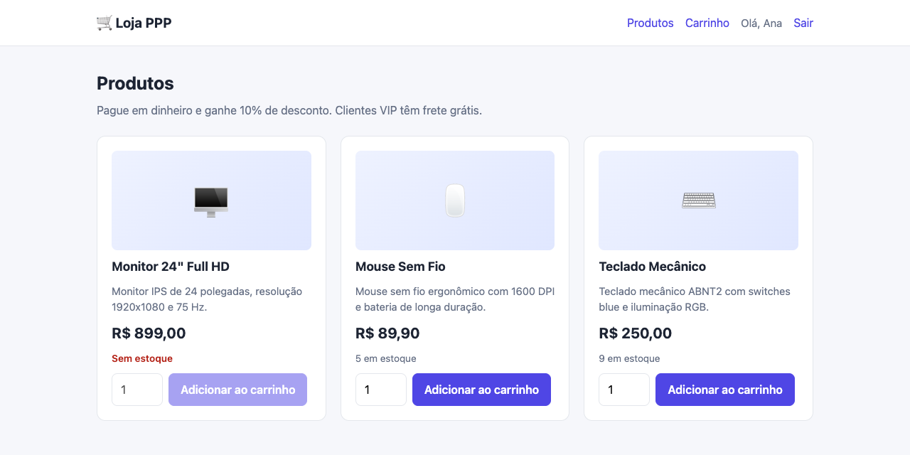
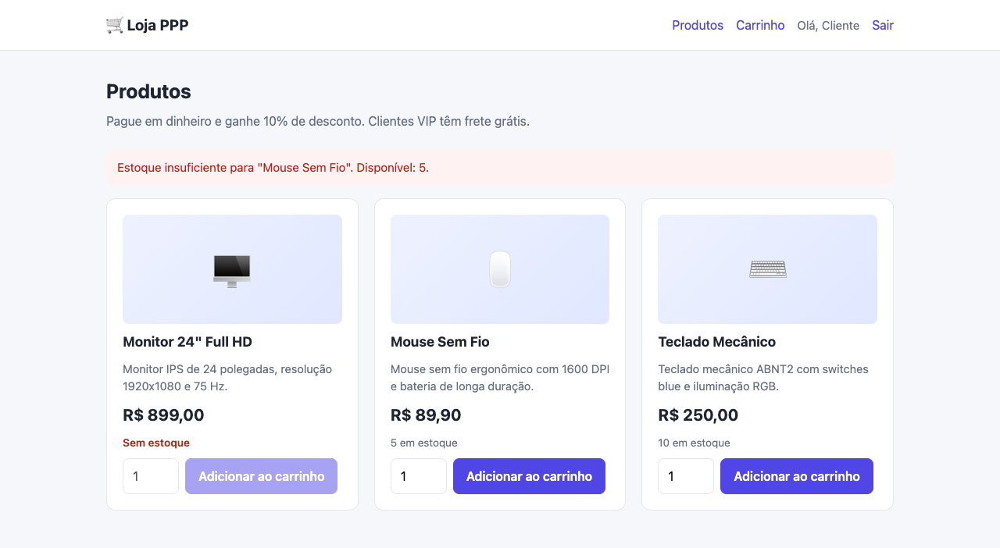
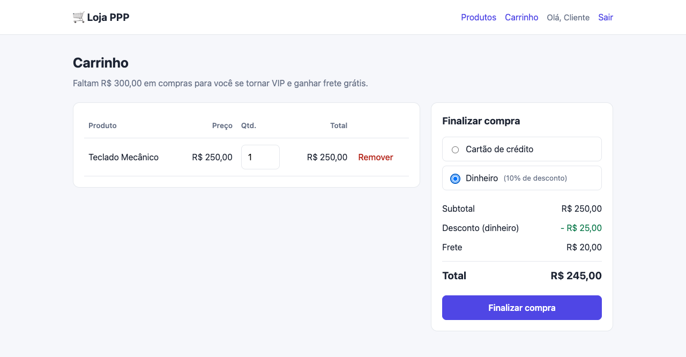
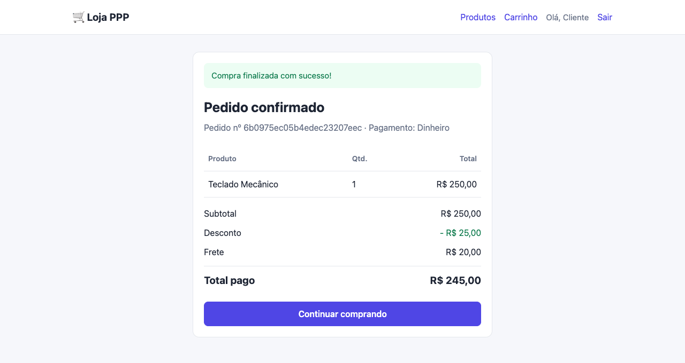

# 🤖 Automação Web — Cypress

> Documento estruturado conforme a **ISO/IEC/IEEE 29119-3:2021**: *Test Procedure Specification* (seções 3 a 6) e *Test Execution Log* (seção 7). Implementa casos da [Especificação de Casos de Teste Web](02-casos-de-teste-web.md) (`ECT-LOJAPPP-WEB-001`).

⬅️ [Índice da documentação de QA](README.md)

---

## 1. Visão geral

| Item | Valor |
|---|---|
| **Identificador** | `AUT-LOJAPPP-WEB-001` |
| **Título** | Procedimentos e registro de execução da automação Web (Cypress) |
| **Versão** | 1.0 |
| **Data** | 27/11/2026 |
| **Autora** | Lilyan Lacerda (QA) |
| **Item de teste** | IT-02 Site Web, versão 1.0.0, commit `f134da6` |
| **Código** | [`cypress/`](../../cypress/) e [`cypress.config.js`](../../cypress.config.js) |

### 1.1 Histórico de alterações

| Versão | Data | Autor | Descrição |
|---|---|---|---|
| 1.0 | 27/11/2026 | Lilyan Lacerda | Automação de 3 casos (CT-WEB-LOG-01, CT-WEB-CAR-04 e CT-WEB-CHK-02) e primeira execução |

---

## 2. Escopo da automação

| Caso | Título | Prioridade | Risco | Por que automatizar |
|---|---|---|---|---|
| [CT-WEB-LOG-01](02-casos-de-teste-web.md#ct-web-log-01---entrar-com-credenciais-válidas) | Entrar com credenciais válidas | Alta | RP05 | Pré-requisito de quase todos os fluxos; funciona como *smoke test* da interface |
| [CT-WEB-CAR-04](02-casos-de-teste-web.md#ct-web-car-04---recusar-adição-que-faz-o-carrinho-passar-do-estoque) | Recusar adição que faz o carrinho passar do estoque | Alta | RP04 (exposição 6) | Regra RN02 com valor-limite; regressão barata de uma regra de negócio crítica |
| [CT-WEB-CHK-02](02-casos-de-teste-web.md#ct-web-chk-02---finalizar-compra-de-não-vip-em-dinheiro-com-desconto) | Finalizar compra de não VIP em dinheiro com desconto | Alta | RP01 (exposição 6) | Fluxo de compra de ponta a ponta com a regra RN01; é o caminho que gera receita |

**Fora desta suíte:** os casos de concorrência (CT-WEB-CHK-11) e de *open redirect* (CT-WEB-LOG-09) estão reprovados por defeitos abertos ([BUG-001](04-report-de-bugs.md) e [BUG-002](04-report-de-bugs.md)). Eles entram na regressão depois da correção, para que a suíte não fique sempre vermelha por defeitos já conhecidos.

---

## 3. Ferramentas e versões

| Ferramenta | Versão | Uso |
|---|---|---|
| [Cypress](https://www.cypress.io/) | 16.4.0 | Execução dos testes E2E |
| [cypress-mochawesome-reporter](https://www.npmjs.com/package/cypress-mochawesome-reporter) | 5.0.0 | Relatório HTML com prints embutidos |
| [start-server-and-test](https://www.npmjs.com/package/start-server-and-test) | 3.0.13 | Sobe a aplicação, espera o health check e roda a suíte com um só comando |
| Node.js | ≥ 18 (executado com 22.23.5) | Runtime |
| Navegador | Google Chrome (modo *headless*). Nesta execução: Chrome for Testing 158 | Execução. O Electron, navegador padrão do Cypress, está **descontinuado** no Cypress 16 |

---

## 4. Estrutura

```
cypress.config.js                 # baseUrl, viewport, pastas de evidência, relatório e variável apiUrl
cypress/
├── e2e/
│   ├── login.cy.js               # CT-WEB-LOG-01
│   ├── carrinho.cy.js            # CT-WEB-CAR-04
│   └── checkout.cy.js            # CT-WEB-CHK-02
└── support/
    ├── e2e.js                    # registra o relatório e os comandos
    └── commands.js               # comandos customizados (abaixo)
docs/qa/evidencias/cypress/
├── relatorio/relatorio-cypress.html   # relatório HTML da última execução
└── screenshots/<arquivo>.cy.js/       # prints da última execução
```

### 4.1 Comandos customizados (`cypress/support/commands.js`)

| Comando | O que faz |
|---|---|
| `cy.criarCliente()` | Cadastra um cliente novo pela API, com e-mail único |
| `cy.loginPorApi(cliente)` | Faz login pela API e grava o token e o usuário no `localStorage`, como o site faz |
| `cy.buscarProduto(nome)` | Busca um produto pelo nome em `GET /api/products` (os IDs mudam a cada inicialização) |
| `cy.adicionarAoCarrinhoPorApi(token, id, qtd)` | Prepara o carrinho pela API |
| `cy.cardDoProduto(id)` | Localiza o card do produto na vitrine pelo `data-testid` |
| `cy.conferirLinha(container, rótulo, valor)` | Confere o valor de uma linha do resumo de compra, repetindo até a tela atualizar |

---

## 5. Como executar

**Pré-requisitos:** Node.js 18+, **Google Chrome** instalado e `npm install` executado. Na primeira instalação, o Cypress baixa o próprio binário (~500 MB).

Suíte completa, subindo a aplicação automaticamente (recomendado):

```bash
npm run test:web
```

Somente os testes, com a aplicação já rodando em outro terminal (`npm start`):

```bash
npm run cy:run
```

Modo interativo, para acompanhar os testes no navegador:

```bash
npm run cy:open
```

Um único arquivo de teste:

```bash
npx cypress run --e2e --spec cypress/e2e/checkout.cy.js
```

Ao final, o relatório fica em `docs/qa/evidencias/cypress/relatorio/relatorio-cypress.html` e os prints em `docs/qa/evidencias/cypress/screenshots/`. As duas pastas são **recriadas a cada execução**, então guardam sempre a evidência da última rodada.

Para usar outro navegador instalado, troque o `--browser` (ex.: `npx cypress run --e2e --browser edge`) ou informe o caminho do executável (`--browser /caminho/para/chrome`).

---

## 6. Procedimentos de teste e decisões técnicas

### 6.1 Princípios aplicados

| Princípio | Como foi aplicado |
|---|---|
| **Preparação pela API, verificação pela interface** | Cadastro, login e carrinho são preparados com `cy.request` (rápido e estável). A interface é usada só para o comportamento que o caso verifica. |
| **Testes independentes** | Cada teste cria o **próprio cliente** (`qa.cypress+<timestamp>@email.com`), sem depender da ordem de execução nem alterar as personas Ana, Bruno e Carla. |
| **Sem dados fixos frágeis** | IDs e estoque dos produtos são lidos da API em tempo de execução. O CT-WEB-CAR-04 usa o estoque **atual** do Mouse, então funciona mesmo sem reiniciar a aplicação. |
| **Sem esperas fixas** | Nenhum `cy.wait(ms)`. O checkout espera a resposta real com `cy.intercept` + `cy.wait('@checkout')`, e as verificações usam a repetição automática do Cypress. |
| **Asserções de negócio explícitas** | Os valores esperados (R$ 250,00, R$ 25,00, R$ 20,00 e R$ 245,00) estão escritos no teste, exatamente como na tabela de decisão do plano, em vez de recalculados no código. |
| **Rastreabilidade** | O nome de cada teste começa com o ID do caso, e o cabeçalho do arquivo indica requisito, risco e condição de teste. |
| **Evidência automática** | Prints nos pontos-chave (`cy.screenshot`) e relatório HTML com os prints embutidos. |

### 6.2 Procedimento por caso

#### CT-WEB-LOG-01 — [`cypress/e2e/login.cy.js`](../../cypress/e2e/login.cy.js)

| Passo do caso | Implementação | Verificações |
|---|---|---|
| Pré-condição | `cy.clearLocalStorage()` | Visitante sem sessão |
| 1. Acessar `/login` | `cy.visit('/login')` | Título "Entrar"; cabeçalho com "Entrar" e "Cadastrar" |
| 2. Informar credenciais da Ana e entrar | `type` em `#email` e `#password` (senha oculta no log); clique em **Entrar** | Redireciona para `/` |
| 3. Conferir o cabeçalho | `within('#nav')` | "Carrinho", "Olá, Ana" e "Sair" visíveis; **sem** selo VIP |
| Extra | `cy.window()` | Token JWT (3 partes) e usuário `ana@email.com` / `isVip: false` gravados no `localStorage` |

#### CT-WEB-CAR-04 — [`cypress/e2e/carrinho.cy.js`](../../cypress/e2e/carrinho.cy.js)

| Passo do caso | Implementação | Verificações |
|---|---|---|
| Pré-condição | `cy.buscarProduto('Mouse Sem Fio')`; `cy.criarCliente()` + `cy.loginPorApi()` | Mouse com estoque > 0; cliente novo e logado |
| 1. Adicionar quantidade = estoque (limite válido) | Quantidade = `mouse.stock` no card; clique em **Adicionar ao carrinho** | Alerta de sucesso "Itens no carrinho: <estoque>." |
| 2. Adicionar mais 1 (limite inválido) | Quantidade = 1; clique em **Adicionar ao carrinho** | Alerta de erro `Estoque insuficiente para "Mouse Sem Fio". Disponível: <estoque>.` |
| 3. Conferir o carrinho | `cy.visit('/carrinho')` | Quantidade do Mouse continua igual ao estoque |

#### CT-WEB-CHK-02 — [`cypress/e2e/checkout.cy.js`](../../cypress/e2e/checkout.cy.js)

| Passo do caso | Implementação | Verificações |
|---|---|---|
| Pré-condição | Cliente novo (R$ 0,00 gastos, não VIP) com 1 Teclado no carrinho, preparado pela API | — |
| 1. Selecionar Dinheiro | `check()` no rádio `cash` | Subtotal **R$ 250,00** · Desconto **− R$ 25,00** · Frete **R$ 20,00** · Total **R$ 245,00** |
| 2. Finalizar compra | `cy.intercept` + clique em **Finalizar compra** + `cy.wait('@checkout')` | `POST /api/checkout` → **201**; redireciona para `/pedido` |
| 3. Conferir o pedido | `within('#content')` e `cy.conferirLinha` | "Compra finalizada com sucesso!", "Pedido confirmado", "Pagamento: Dinheiro", Teclado × 1, Desconto − R$ 25,00, Frete R$ 20,00, **Total pago R$ 245,00** |
| Efeito pós-compra (RF06) | `cy.visit('/carrinho')` | "Seu carrinho está vazio." |

---

## 7. Registro de execução

### 7.1 Execução de 27/11/2026

| Item | Valor |
|---|---|
| Comando | `npm run test:web` (aplicação iniciada do zero pelo `start-server-and-test`) |
| Ambiente | Linux · Node.js 22.23.5 · Cypress 16.4.0 · Chrome for Testing 158 *headless* · 1280 × 800 |
| Execuções | 2 seguidas, para verificar estabilidade |

| Caso | Arquivo | 1ª execução | 2ª execução |
|---|---|---|---|
| CT-WEB-LOG-01 | `login.cy.js` | ✅ Aprovado | ✅ Aprovado |
| CT-WEB-CAR-04 | `carrinho.cy.js` | ✅ Aprovado | ✅ Aprovado |
| CT-WEB-CHK-02 | `checkout.cy.js` | ✅ Aprovado | ✅ Aprovado |
| **Total** | | **3/3** · ~4 s | **3/3** · ~4 s |

```
  │ ✔  carrinho.cy.js                           00:01        1        1        -        -        - │
  │ ✔  checkout.cy.js                           00:01        1        1        -        -        - │
  │ ✔  login.cy.js                              00:01        1        1        -        -        - │
    ✔  All specs passed!                        00:04        3        3        -        -        -
```

### 7.2 Evidências

- 📊 **Relatório HTML:** [`evidencias/cypress/relatorio/relatorio-cypress.html`](evidencias/cypress/relatorio/relatorio-cypress.html). Baixe o arquivo e abra no navegador; os prints estão embutidos.
- 📸 **Prints:**

| CT-WEB-LOG-01: cliente logado | CT-WEB-CAR-04: estoque insuficiente |
|---|---|
|  |  |

| CT-WEB-CHK-02: resumo com desconto | CT-WEB-CHK-02: pedido confirmado |
|---|---|
|  |  |

### 7.3 Problemas encontrados durante a automação

| Problema | Causa | Solução |
|---|---|---|
| `Cypress.env()` gerava erro ao ler a URL da API | O Cypress 16 removeu `Cypress.env()` | Migrado para a chave `expose` no `cypress.config.js` e `Cypress.expose('apiUrl')` nos comandos |
| A verificação do resumo comparava `"SubtotalR$ 250,00"` | Rótulo e valor ficam em `<span>` separados, sem espaço entre eles; o valor usa espaço não separável (U+00A0) | Criado o comando `cy.conferirLinha`, que localiza a linha pelo rótulo exato, compara só o valor e normaliza o U+00A0 |
| Aviso "The Electron browser is deprecated" na execução | O Cypress 16 descontinuou o Electron como navegador de teste | Scripts `cy:run` e `cy:open` passaram a usar `--browser chrome` |
| Prints copiados para a pasta de evidências sumiam após a execução seguinte | O relatório apaga a própria pasta de saída a cada execução | Relatório e prints em subpastas separadas (`relatorio/` e `screenshots/`), ambas configuradas no `cypress.config.js` |
| Risco de ler o resumo antigo logo após trocar a forma de pagamento | O resumo é recarregado pela API depois da troca | `cy.conferirLinha` usa `should(callback)`, que repete a verificação até o valor atualizar, em vez de `.then()`, que lê uma vez só |

---

## 8. Próximos passos

- Incluir na suíte o **CT-WEB-CHK-11** (duas abas finalizando a compra) depois da correção do [BUG-001](04-report-de-bugs.md), como teste de regressão do defeito.
- Incluir o **CT-WEB-LOG-09** (*open redirect*) depois da correção do [BUG-002](04-report-de-bugs.md).
- Executar a suíte no **GitHub Actions** a cada *push*, junto com as suítes de API e performance.
