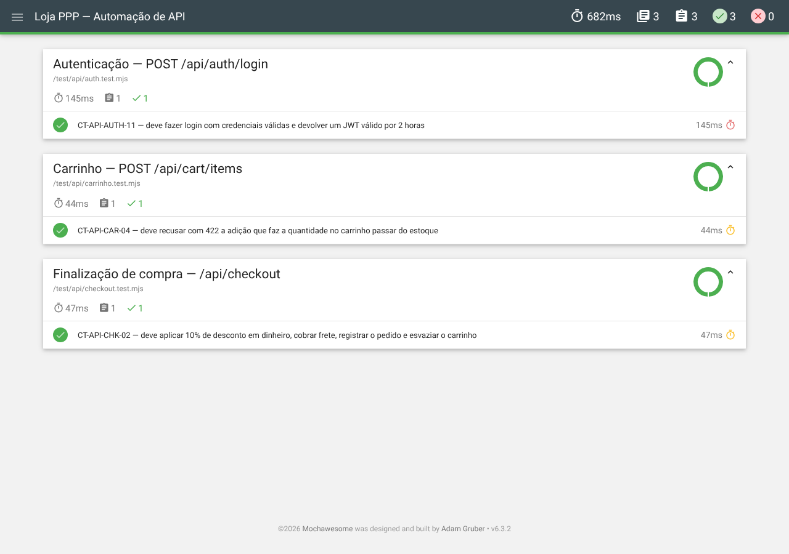
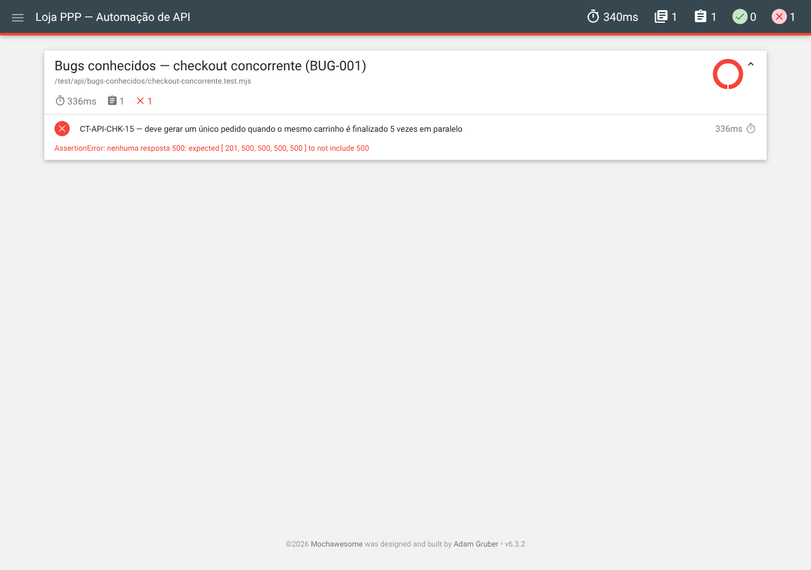

# 🔌 Automação de API — JavaScript (Mocha + Chai + Supertest)

> Documento estruturado conforme a **ISO/IEC/IEEE 29119-3:2021**: *Test Procedure Specification* (seções 3 a 6) e *Test Execution Log* (seção 7). Implementa casos da [Especificação de Casos de Teste API](03-casos-de-teste-api.md) (`ECT-LOJAPPP-API-001`).

⬅️ [Índice da documentação de QA](README.md)

---

## 1. Visão geral

| Item | Valor |
|---|---|
| **Identificador** | `AUT-LOJAPPP-API-001` |
| **Título** | Procedimentos e registro de execução da automação de API |
| **Versão** | 1.0 |
| **Data** | 27/11/2026 |
| **Autora** | Lilyan Lacerda (QA) |
| **Item de teste** | IT-01 API REST, versão 1.0.0, commit `f134da6` |
| **Código** | [`test/api/`](../../test/api/) e [`.mocharc.json`](../../.mocharc.json) |

### 1.1 Histórico de alterações

| Versão | Data | Autor | Descrição |
|---|---|---|---|
| 1.0 | 27/11/2026 | Lilyan Lacerda | Automação de 3 casos (CT-API-AUTH-11, CT-API-CAR-04 e CT-API-CHK-02), suíte de bugs conhecidos (CT-API-CHK-15) e primeira execução |

---

## 2. Escopo da automação

### 2.1 Suíte principal (regressão)

| Caso | Título | Prioridade | Risco | Por que automatizar |
|---|---|---|---|---|
| [CT-API-AUTH-11](03-casos-de-teste-api.md#ct-api-auth-11---fazer-login-com-credenciais-válidas) | Fazer login com credenciais válidas | Alta | RP05 | Porta de entrada de todas as rotas protegidas; valida o contrato do token (dono e validade de 2 horas) |
| [CT-API-CAR-04](03-casos-de-teste-api.md#ct-api-car-04---recusar-adição-que-faz-o-carrinho-passar-do-estoque) | Recusar adição que faz o carrinho passar do estoque | Alta | RP04 (exposição 6) | Regra RN02 com valor-limite, verificada direto no contrato (status 422 e mensagem) |
| [CT-API-CHK-02](03-casos-de-teste-api.md#ct-api-chk-02---finalizar-compra-de-não-vip-em-dinheiro-com-desconto) | Finalizar compra de não VIP em dinheiro com desconto | Alta | RP01 (exposição 6) | Regra RN01 de ponta a ponta, com todos os efeitos pós-compra: pedido, carrinho, total gasto e estoque |

### 2.2 Suíte de bugs conhecidos

| Caso | Título | Situação |
|---|---|---|
| [CT-API-CHK-15](03-casos-de-teste-api.md#ct-api-chk-15--gerar-um-único-pedido-com-checkouts-simultâneos) | Gerar um único pedido com checkouts simultâneos | ❌ **Falha de propósito** enquanto o [BUG-001](04-report-de-bugs.md) estiver aberto |

O teste de concorrência é difícil de executar à mão: precisa disparar 5 requisições no mesmo instante. Por isso foi automatizado mesmo estando reprovado. Ele fica **separado da suíte principal** para que a regressão continue verde e confiável. Quando o BUG-001 for corrigido, basta mover o arquivo para `test/api/` e ele passa a proteger a correção.

---

## 3. Ferramentas e versões

| Ferramenta | Versão | Uso |
|---|---|---|
| [Mocha](https://mochajs.org/) | 12.0.3 | Executor de testes (`describe` / `it`, *hooks*, *timeout*) |
| [Chai](https://www.chaijs.com/) | 6.3.0 | Asserções (`expect`) |
| [Supertest](https://github.com/forwardemail/supertest) | 7.3.2 | Requisições HTTP à API |
| [Mochawesome](https://github.com/adamgruber/mochawesome) | 8.1.1 | Relatório HTML |
| [start-server-and-test](https://www.npmjs.com/package/start-server-and-test) | 3.0.13 | Sobe a aplicação, espera o health check e roda a suíte |
| Node.js | **≥ 20.19** (executado com 22.23.5) | Runtime. O Mocha 12 não suporta Node 18 |

Os arquivos de teste usam **ES Modules** (`.mjs`, com `import`), porque o Chai 6 e o Mocha 12 são distribuídos só nesse formato. A aplicação continua em CommonJS; as duas coisas convivem sem conflito.

---

## 4. Estrutura

```
.mocharc.json                          # timeout e configuração do relatório
test/api/
├── support/api.mjs                    # funções de apoio (abaixo)
├── auth.test.mjs                      # CT-API-AUTH-11
├── carrinho.test.mjs                  # CT-API-CAR-04
├── checkout.test.mjs                  # CT-API-CHK-02
└── bugs-conhecidos/
    └── checkout-concorrente.test.mjs  # CT-API-CHK-15 (BUG-001)
docs/qa/evidencias/api/                # relatórios HTML e prints
```

### 4.1 Funções de apoio (`test/api/support/api.mjs`)

| Função | O que faz |
|---|---|
| `api` | Cliente Supertest apontando para `API_URL` (padrão `http://localhost:3030`) |
| `auth(token)` | Monta o cabeçalho `Authorization: Bearer <token>` |
| `criarCliente()` | Cadastra um cliente novo com e-mail único (`qa.api+<timestamp>@email.com`) |
| `login(cliente)` | Faz login e devolve o token |
| `clienteLogado()` | Cria um cliente e já faz login |
| `buscarProduto(nome)` | Busca um produto pelo nome em `GET /api/products` (os IDs mudam a cada inicialização) |
| `decodificarJwt(token)` | Lê o *payload* do token para conferir `sub`, `iat` e `exp` |

---

## 5. Como executar

**Pré-requisitos:** Node.js 20.19+ e `npm install` executado.

Suíte principal, subindo a aplicação automaticamente (recomendado):

```bash
npm run test:api
```

Suíte de bugs conhecidos (falha enquanto o BUG-001 estiver aberto):

```bash
npm run test:api:bugs
```

Somente os testes, com a aplicação já rodando em outro terminal (`npm start`):

```bash
npm run api:run
```

Contra outro endereço (ex.: outra porta):

```bash
API_URL=http://localhost:4000 npm run api:run
```

Os relatórios ficam em `docs/qa/evidencias/api/relatorio-api.html` e `docs/qa/evidencias/api/relatorio-bugs-conhecidos.html`, substituídos a cada execução.

---

## 6. Procedimentos de teste e decisões técnicas

### 6.1 Princípios aplicados

| Princípio | Como foi aplicado |
|---|---|
| **Caixa-preta pela rede** | Os testes chamam a API em execução por HTTP, como um cliente real (front-end, app mobile ou parceiro), em vez de importar o código da aplicação. |
| **Testes independentes** | Cada teste cria o próprio cliente; nenhum depende de outro nem da ordem de execução, e as personas Ana, Bruno e Carla ficam intactas. A Ana é usada só no login, que não altera dados. |
| **Sem dados fixos frágeis** | IDs e estoque são lidos da API em tempo de execução. O CT-API-CAR-04 usa o estoque **atual** do Mouse, e o CT-API-CHK-02 confere a baixa de estoque relativa ao valor inicial. |
| **Asserções de contrato e de negócio** | Status HTTP, `Content-Type`, chaves do corpo, mensagens de erro exatas e valores monetários da tabela de decisão, escritos de forma explícita no teste. |
| **Segurança** | Confere que a senha nunca aparece nas respostas e que o token é aceito por uma rota protegida. |
| **Rastreabilidade** | O nome de cada teste começa com o ID do caso, e o cabeçalho do arquivo indica requisito, risco e condição de teste. |
| **Separação de bugs conhecidos** | Testes que falham por defeitos abertos ficam em `bugs-conhecidos/`, com script próprio, para não mascarar regressões novas. |

### 6.2 Procedimento por caso

#### CT-API-AUTH-11 — [`test/api/auth.test.mjs`](../../test/api/auth.test.mjs)

| Passo | Requisição | Verificações |
|---|---|---|
| 1 | `POST /api/auth/login` com `ana@email.com` / `123456` | **200**; `Content-Type` JSON; corpo com exatamente `token` e `user` |
| 2 | — | `user` = Ana Silva, `ana@email.com`, `totalSpent: 0`, `isVip: false`; `id` preenchido; **sem** `password` |
| 3 | — | Token com 3 partes; no *payload*, `sub` = `user.id` e `exp − iat` = **7200** s (2 horas) |
| 4 | `GET /api/users/me` com o token | **200** e e-mail da Ana |

#### CT-API-CAR-04 — [`test/api/carrinho.test.mjs`](../../test/api/carrinho.test.mjs)

| Passo | Requisição | Verificações |
|---|---|---|
| Pré-condição | `GET /api/products`; cadastro e login de cliente novo | Mouse com estoque > 0 |
| 1 | `POST /api/cart/items` com `quantity` = estoque (limite válido) | **201**; 1 item com a quantidade igual ao estoque |
| 2 | `POST /api/cart/items` com `quantity: 1` (limite inválido) | **422**; corpo exatamente `{ "error": "Estoque insuficiente para \"Mouse Sem Fio\". Disponível: <estoque>." }` |
| 3 | `GET /api/cart` | Carrinho inalterado: 1 item, quantidade = estoque, `totalItems` = estoque |

#### CT-API-CHK-02 — [`test/api/checkout.test.mjs`](../../test/api/checkout.test.mjs)

| Passo | Requisição | Verificações |
|---|---|---|
| Pré-condição | Cliente novo (R$ 0,00, não VIP) com 1 Teclado no carrinho | — |
| 1 | `GET /api/checkout/summary?paymentMethod=cash` | **200**; `subtotal: 250`, `discount: 25`, `shipping: 20`, `total: 245`, `isVip: false` |
| 2 | `POST /api/checkout` · `{ "paymentMethod": "cash" }` | **201**; `order` com os mesmos valores, `vipAtPurchase: false`, `becameVip: false`, `id` e `createdAt` válidos, itens exatos; `user.totalSpent: 245`; sem `password` |
| 3 | `GET /api/cart` | Exatamente `{ "items": [], "totalItems": 0, "subtotal": 0 }` |
| 4 | `GET /api/users/me` | `totalSpent: 245` |
| Extra | `GET /api/products/{id}` | Estoque do Teclado = estoque inicial − 1 |

#### CT-API-CHK-15 — [`test/api/bugs-conhecidos/checkout-concorrente.test.mjs`](../../test/api/bugs-conhecidos/checkout-concorrente.test.mjs)

| Passo | Requisição | Verificações (resultado esperado após a correção) |
|---|---|---|
| Pré-condição | Cliente novo com 1 Teclado no carrinho | — |
| 1 | 5 × `POST /api/checkout` em paralelo (`Promise.all`) | Nenhum **500**; exatamente 1 **201** e 4 **422** |
| 2 | `GET /api/products/{id}` | Estoque baixado **uma** vez |
| 3 | `GET /api/users/me` | `totalSpent: 245` (uma cobrança) |

O teste imprime no relatório os status recebidos, o estoque antes e depois e o total gasto **antes** das asserções. Assim, quando falha, mostra exatamente o tamanho do problema.

---

## 7. Registro de execução

### 7.1 Execução de 27/11/2026

| Item | Valor |
|---|---|
| Comandos | `npm run test:api` (2 vezes seguidas) e `npm run test:api:bugs`, com a aplicação iniciada do zero pelo `start-server-and-test` |
| Ambiente | Linux · Node.js 22.23.5 · Mocha 12.0.3 · Chai 6.3.0 · Supertest 7.3.2 |

**Suíte principal**

| Caso | Arquivo | 1ª execução | 2ª execução |
|---|---|---|---|
| CT-API-AUTH-11 | `auth.test.mjs` | ✅ Aprovado (199 ms) | ✅ Aprovado (145 ms) |
| CT-API-CAR-04 | `carrinho.test.mjs` | ✅ Aprovado (55 ms) | ✅ Aprovado (44 ms) |
| CT-API-CHK-02 | `checkout.test.mjs` | ✅ Aprovado (41 ms) | ✅ Aprovado (47 ms) |
| **Total** | | **3/3** · 832 ms | **3/3** · 682 ms |

```
  Autenticação — POST /api/auth/login
    ✔ CT-API-AUTH-11 — deve fazer login com credenciais válidas e devolver um JWT válido por 2 horas (145ms)
  Carrinho — POST /api/cart/items
    ✔ CT-API-CAR-04 — deve recusar com 422 a adição que faz a quantidade no carrinho passar do estoque (44ms)
  Finalização de compra — /api/checkout
    ✔ CT-API-CHK-02 — deve aplicar 10% de desconto em dinheiro, cobrar frete, registrar o pedido e esvaziar o carrinho (47ms)

  3 passing (682ms)
```

**Suíte de bugs conhecidos**

| Caso | Resultado | Detalhe |
|---|---|---|
| CT-API-CHK-15 | ❌ Reprovado (esperado) | Status `[201, 500, 500, 500, 500]` · estoque 10 → **5** (1 compra) · `totalSpent: 245` → confirma o [BUG-001](04-report-de-bugs.md) |

```
      status: [201, 500, 500, 500, 500] · estoque: 10 → 5 · totalSpent: 245
    1) CT-API-CHK-15 — deve gerar um único pedido quando o mesmo carrinho é finalizado 5 vezes em paralelo

  0 passing (340ms)
  1 failing

  AssertionError: nenhuma resposta 500: expected [ 201, 500, 500, 500, 500 ] to not include 500
```

### 7.2 Evidências

- 📊 **Relatórios HTML** (baixe e abra no navegador): [`relatorio-api.html`](evidencias/api/relatorio-api.html) e [`relatorio-bugs-conhecidos.html`](evidencias/api/relatorio-bugs-conhecidos.html).

| Suíte principal: 3/3 aprovados | Bugs conhecidos: BUG-001 reproduzido |
|---|---|
|  |  |

### 7.3 Problemas encontrados durante a automação

| Problema | Causa | Solução |
|---|---|---|
| `require('chai')` não funcionaria | Chai 6 e Mocha 12 são distribuídos só como ES Modules | Testes escritos em `.mjs`, com `import` |
| `npm run test:api:bugs` executava também os testes da suíte principal | O Mocha **soma** os arquivos do `.mocharc.json` com os passados na linha de comando | A lista de arquivos saiu do `.mocharc.json` e foi para cada script (`api:run` e `api:run:bugs`) |
| Os dois relatórios se sobrescreviam | Mesmo nome de arquivo | O script de bugs conhecidos passa `--reporter-option reportFilename=relatorio-bugs-conhecidos` |

---

## 8. Próximos passos

- Depois da correção do [BUG-001](04-report-de-bugs.md), mover `checkout-concorrente.test.mjs` para `test/api/`, tornando-o parte da regressão.
- Automatizar os casos de segurança (CT-API-SEC-01 a 08) e a tabela de decisão completa (CT-API-CHK-01 a 04) como testes parametrizados.
- Executar a suíte no **GitHub Actions** a cada *push*, junto com Cypress e k6.
