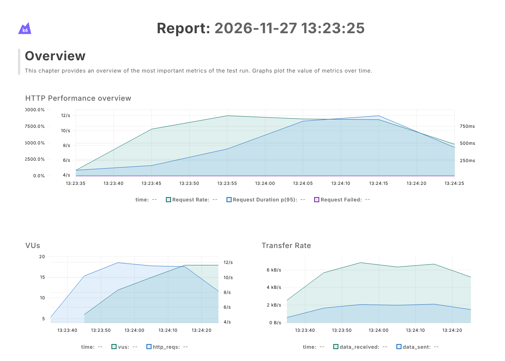

# ⚡ Performance — k6

> Documento estruturado conforme a **ISO/IEC/IEEE 29119-3:2021**: *Test Procedure Specification* (seções 2 a 5) e *Test Result* (seções 6 e 7). Implementa os cenários e as metas da seção 6.4.2 do [Plano de Testes](01-plano-de-testes.md#642-critérios-de-desempenho-k6).

⬅️ [Índice da documentação de QA](README.md)

---

## 1. Visão geral

| Item | Valor |
|---|---|
| **Identificador** | `PERF-LOJAPPP-001` |
| **Título** | Procedimentos e resultados dos testes de performance |
| **Versão** | 1.1 |
| **Data** | 27/11/2026 |
| **Autora** | Lilyan Lacerda (QA) |
| **Item de teste** | IT-01 API REST, versão 1.0.0, commit `f134da6` |
| **Código** | [`performance/`](../../performance/) |
| **Requisitos / riscos** | RNF02 · RP09 (tempo de resposta sob carga) · ISO/IEC 25010: Eficiência de desempenho |

### 1.1 Histórico de alterações

| Versão | Data | Autor | Descrição |
|---|---|---|---|
| 1.0 | 27/11/2026 | Lilyan Lacerda | 3 cenários implementados e executados; registro do BUG-008 |
| 1.1 | 27/11/2026 | Lilyan Lacerda | Reprodução em uma segunda máquina (Mac da autora) e comparação entre os ambientes (seção 6.4) |

### 1.2 Resultado em uma linha

**No ambiente de referência, 2 de 3 cenários atendem às metas; no Mac da autora, os 3 atendem.** A navegação e a compra respondem bem nas duas máquinas. Nas duas, porém, **cada login trava a API inteira enquanto é processado**: no ambiente de referência isso estoura as metas com 20 usuários; no Mac, mais rápido, fica dentro das metas, mas a leitura de produtos ainda espera na fila dos logins. Esse defeito foi registrado como [BUG-008](04-report-de-bugs.md#bug-008--login-sob-carga-ultrapassa-a-meta-de-tempo-e-deixa-toda-a-api-lenta).

---

## 2. Cenários e metas

| ID | Cenário | Tipo de teste | Carga | Metas (*thresholds*) |
|---|---|---|---|---|
| **PERF-01** | Endpoints públicos: `/health`, `/products`, `/products/{id}` | *Smoke* | 1 usuário virtual (VU) por 30 s | erros < 1% · p95 < 300 ms · checks > 99% |
| **PERF-02** | Login das personas + 1 usuário lendo produtos em paralelo | Carga | Rampa 0 → 10 → 20 → 0 VUs em 60 s | erros < 1% · **login p95 < 800 ms** · **produtos p95 < 300 ms** · checks > 99% |
| **PERF-03** | Jornada de compra: navegação (carrinho e prévia) + compras efetivadas | Carga | Navegação: rampa até 10 VUs em 60 s · Compra: 10 compras por 5 VUs | erros < 1% · navegação p95 < 1000 ms · prévia p95 < 1000 ms · **checkout p95 < 1000 ms** · checks > 99% |

**Por que essas metas:** as leituras simples (PERF-01) devem ser praticamente instantâneas. O login usa bcrypt, que é lento **de propósito** para dificultar ataques de força bruta, e por isso recebeu uma meta mais folgada. A jornada de compra envolve várias escritas no banco, e 1 s é um limite comum para o usuário não perceber lentidão.

---

## 3. Ferramentas e ambiente

| Item | Valor |
|---|---|
| Ferramenta | [k6](https://grafana.com/docs/k6/latest/) v1.8.3 |
| Relatórios | Resumo no terminal, `--summary-export` (JSON) e *web dashboard* exportado em HTML |
| Aplicação | `npm start`, banco em memória, iniciada do zero antes da execução (`npm run test:perf`) |
| Máquina de referência | Linux, 4 vCPUs, Node.js 22.23.5. O k6 e a aplicação rodam na **mesma máquina**. As evidências em `docs/qa/evidencias/k6/` são desta máquina |
| Segunda máquina | Mac da autora (macOS), mesmos scripts e mesmo commit. Resultados transcritos na seção 6.4 |

> ⚠️ **Limitação (Plano, risco RJ05):** os números valem como **linha de base comparativa**, não como capacidade de produção. Em outro hardware os valores absolutos mudam, mas os comportamentos observados (como o bloqueio do BUG-008) se repetem.

---

## 4. Estrutura e decisões técnicas

```
performance/
├── lib/api.js                 # BASE_URL, parâmetros com nome (tags), login e cadastro
├── perf-01-smoke.js           # PERF-01
├── perf-02-carga-login.js     # PERF-02
├── perf-03-jornada-compra.js  # PERF-03
└── run-all.mjs                # roda os 3 cenários e guarda as evidências
docs/qa/evidencias/k6/         # saída, resumo JSON, dashboard HTML e print de cada cenário
```

| Decisão | Motivo |
|---|---|
| **Requisições com nome** (`tags: { name }`) | Agrupa as métricas por endpoint (login, prévia, checkout...) e permite metas específicas, como `http_req_duration{name:checkout}` |
| **Checks de negócio**, não só de status | Sob carga, a API também tem que calcular certo. Ex.: prévia de 2 Mouses em dinheiro = **R$ 181,82**; compra de 1 Teclado no cartão = **R$ 270,00** |
| **Cada usuário virtual com o próprio cliente** | Carrinhos independentes, sem colisões entre VUs e sem alterar as personas do seed |
| **PERF-02 com um "usuário de leitura" em paralelo** | Mede o efeito dos logins **no resto da API**, não só no próprio login. Foi o que revelou o BUG-008 |
| **Verificação de estoque no `teardown`** | No fim do PERF-03, o estoque do Teclado tem que ter baixado exatamente o número de compras (10 → 0): consistência dos dados sob carga |
| **`run-all.mjs` em vez de `&&`** | Com `&&`, uma meta reprovada no PERF-02 impedia o PERF-03 de rodar. O executor roda sempre os 3 e resume o resultado |

### 4.1 Desvio do plano: compras limitadas pelo estoque

O plano previa a jornada completa (login → carrinho → prévia → checkout) com 10 VUs por cerca de 1 minuto. Mas **a aplicação não tem rota para repor estoque**, e o Teclado começa com 10 unidades: depois de 10 compras, todo checkout retornaria 422. Isso contaminaria a taxa de erro e não mediria a performance real.

**Solução adotada:** o PERF-03 foi dividido em dois cenários paralelos:
- **navegação**: até 10 VUs montando carrinho, alterando quantidade, consultando a prévia e esvaziando, sem consumir estoque, durante 60 s;
- **compra**: exatamente **10 compras** de clientes diferentes, por 5 VUs simultâneos, começando quando a navegação já está no pico.

O `setup()` do script **recusa a execução** se o estoque for menor que o número de compras, com a mensagem "Reinicie a aplicação". Isso evita resultados enganosos.

---

## 5. Como executar

**Pré-requisitos:** [k6 instalado](https://grafana.com/docs/k6/latest/set-up/install-k6/) e no PATH, além de `npm install` executado.

Instalação do k6 no Windows:

```bash
winget install k6 --source winget
```

No macOS:

```bash
brew install k6
```

Os 3 cenários, subindo a aplicação do zero (recomendado, porque o PERF-03 precisa do estoque inicial):

> ⚠️ **Pare qualquer instância da aplicação antes** (`Ctrl + C` no terminal do `npm start`; no macOS ou Linux também `lsof -ti :3030 | xargs kill`). Se a porta 3030 já estiver respondendo, o `test:perf` usa a aplicação que já existe, com o estoque consumido por testes anteriores, e o PERF-03 se recusa a rodar com a mensagem "Estoque do Teclado (…) menor que o número de compras".

```bash
npm run test:perf
```

Os 3 cenários com a aplicação já rodando e recém-iniciada:

```bash
npm run perf:all
```

Um cenário isolado:

```bash
npm run perf:02
```

Contra outro endereço:

```bash
k6 run -e BASE_URL=http://localhost:4000 performance/perf-01-smoke.js
```

Ao final, cada cenário gera em `docs/qa/evidencias/k6/`: a saída do terminal (`-saida.txt`, só pelo `perf:all`/`test:perf`), o resumo (`-resumo.json`) e o dashboard (`-dashboard.html`).

---

## 6. Resultados — execução de 27/11/2026

Comando: `npm run test:perf` (aplicação iniciada do zero). As seções 6.1 a 6.3 trazem a **máquina de referência**, com o PERF-02 executado 3 vezes e o mesmo resultado. A seção 6.4 compara com a segunda máquina.

### 6.1 PERF-01 — Smoke dos endpoints públicos ✅

| Meta | Resultado | |
|---|---|---|
| p95 < 300 ms | **4,65 ms** | ✅ |
| Erros < 1% | **0%** (0 de 91) | ✅ |
| Checks > 99% | **100%** (180 de 180) | ✅ |

Média de 2,24 ms e máximo de 9,79 ms. Essa é a **linha de base** da API sem carga.

### 6.2 PERF-02 — Carga no login ❌

| Meta | Resultado | |
|---|---|---|
| Login p95 < 800 ms | **803,92 ms** | ❌ |
| Produtos p95 < 300 ms, durante os logins | **430,97 ms** | ❌ |
| Erros < 1% | **0%** (0 de 582) | ✅ |
| Checks > 99% | **100%** (1.562 de 1.562) | ✅ |

| Métrica | Login | Produtos (em paralelo) | Produtos sem carga (PERF-01) |
|---|---|---|---|
| Mínimo | 89 ms | 2,15 ms | 0,83 ms |
| Mediana | 334 ms | 92 ms | 2,05 ms |
| p95 | **804 ms** | **431 ms** | **4,65 ms** |
| Máximo | 1,19 s | 826 ms | 9,79 ms |
| Volume | 490 logins (~8,1/s) | 92 leituras | — |

| Repetição | Login p95 | Produtos p95 |
|---|---|---|
| 1ª (sem o cenário de leitura) | 800,36 ms | — |
| 2ª | 814,21 ms | 483,97 ms |
| 3ª (final) | 803,92 ms | 430,97 ms |



*No gráfico, a vazão (verde) para de crescer em ~11 a 12 req/s enquanto o p95 (azul) continua subindo: o servidor está saturado.*

### 6.3 PERF-03 — Jornada de compra ✅

| Meta | Resultado | |
|---|---|---|
| Navegação p95 < 1000 ms | **30,54 ms** | ✅ |
| Prévia p95 < 1000 ms | **30,95 ms** | ✅ |
| Checkout p95 < 1000 ms | **77,03 ms** | ✅ |
| Erros < 1% | **0%** (0 de 2.197) | ✅ |
| Checks > 99% | **100%** | ✅ |
| Estoque final consistente | Teclado **10 → 0** após 10 compras | ✅ |

| Operação | Execuções | Mediana | p95 | Máximo |
|---|---|---|---|---|
| Checkout | 10 | 55,9 ms | 77,0 ms | 82,8 ms |
| Prévia | 435 | 3,8 ms | 31,0 ms | 454,9 ms |
| Navegação (todas as requisições) | ~2.150 | 4,7 ms | 30,5 ms | **833,1 ms** |

Todos os valores calculados sob carga estavam corretos: 425 prévias de R$ 181,82, 10 prévias e 10 pedidos de R$ 270,00.

**Atenção ao máximo de 833 ms na navegação:** a mediana é 4,7 ms. Os picos coincidem com os 20 cadastros e logins do cenário de compra, ou seja, é o mesmo efeito do BUG-008 aparecendo em um cenário que, no geral, passou.

### 6.4 Reprodução em uma segunda máquina (Mac da autora)

Os mesmos scripts, com a aplicação recém-iniciada, foram executados no Mac da autora. **Todas as metas foram atendidas**:

| Cenário | Métrica (p95) | Meta | Referência (Linux, 4 vCPUs) | Mac da autora |
|---|---|---|---|---|
| PERF-02 | Login | < 800 ms | ❌ 803,92 ms | ✅ **115,15 ms** |
| PERF-02 | Produtos durante os logins | < 300 ms | ❌ 430,97 ms | ✅ **89,26 ms** |
| PERF-03 | Checkout | < 1000 ms | ✅ 77,03 ms | ✅ **11,76 ms** |
| PERF-03 | Prévia | < 1000 ms | ✅ 30,95 ms | ✅ **5,37 ms** |
| PERF-03 | Navegação | < 1000 ms | ✅ 30,54 ms | ✅ **14,39 ms** |

| Sinal do BUG-008 | Referência | Mac da autora |
|---|---|---|
| Login mais rápido (mínimo) | 89 ms | 49,7 ms |
| Produtos durante os logins: **melhor caso** (mínimo) | 2,15 ms | 0,38 ms |
| Produtos durante os logins: **mediana** | 92 ms | **40,6 ms** (~100× o melhor caso) |
| Vazão de login | ~8,1/s | ~10,4/s |
| Máximo da navegação no PERF-03 | 833 ms | 399 ms (mediana: 3,6 ms) |
| Erros | 0% | 0% |

**Leitura:** o Mac calcula cada bcrypt em cerca de metade do tempo, então a fila não chega a estourar as metas com 20 usuários. Mas o mecanismo é o mesmo: a mediana da leitura de produtos (40,6 ms) fica cerca de 100 vezes acima do melhor caso, porque a requisição espera os logins na frente dela terminarem. Com mais usuários, ou em um servidor de nuvem com vCPUs mais modestos, como o de referência, as metas voltam a ser reprovadas.

> Isso confirma o risco **RJ05** do plano: os **valores absolutos** dependem do hardware e servem como linha de base comparativa; o **comportamento** (bloqueio da API pelos logins) se repete nas duas máquinas.

---

## 7. Análise

### 7.1 O que está bom
- **Leitura e regras de negócio são rápidas:** consultas em poucos milissegundos, e checkout com p95 abaixo de 80 ms mesmo com 15 usuários simultâneos.
- **Zero erros** em todos os cenários: a API fica lenta sob pressão, mas não falha.
- **Cálculos corretos sob carga** (desconto, frete) e **estoque consistente** quando as compras são de clientes diferentes.

### 7.2 O que precisa de atenção — BUG-008

O login usa `bcryptjs`, um bcrypt em **JavaScript puro**. O Node.js executa o JavaScript em **uma única thread**, então cada login a ocupa por cerca de 89 ms, e **nenhuma outra requisição é atendida nesse tempo**:

```
Capacidade teórica ≈ 1000 ms ÷ 89 ms ≈ 11 logins/s    (medido: vazão estaciona em ~11–12 req/s)
Demanda do PERF-02 com 20 VUs ≈ 20 ÷ ~1,3 s ≈ 15 logins/s   → fila → tempo de resposta sobe
```

Consequência para o negócio: um pico de logins, por exemplo na abertura de uma promoção, ou um ataque de força bruta, **deixa a loja inteira lenta**, inclusive a vitrine e o checkout. Em hardware mais rápido o limite fica mais alto (no Mac da autora as metas passaram com 20 usuários), mas continua existindo: a capacidade de login é limitada a um único núcleo do processador, não importa quantos a máquina tenha. Correções sugeridas no [BUG-008](04-report-de-bugs.md#bug-008--login-sob-carga-ultrapassa-a-meta-de-tempo-e-deixa-toda-a-api-lenta): biblioteca `bcrypt` nativa (calcula fora da thread principal), várias instâncias da aplicação e limite de tentativas de login.

### 7.3 Relação com o BUG-001

Os cenários de performance usam **clientes diferentes** em cada compra e, por isso, **não** reproduzem o [BUG-001](04-report-de-bugs.md) (mesmo carrinho finalizado em paralelo). Esse defeito é coberto pelo teste funcional automatizado CT-API-CHK-15 (`npm run test:api:bugs`).

---

## 8. Evidências

| Cenário | Saída | Resumo | Dashboard |
|---|---|---|---|
| PERF-01 | [perf-01-saida.txt](evidencias/k6/perf-01-saida.txt) | [perf-01-resumo.json](evidencias/k6/perf-01-resumo.json) | [HTML](evidencias/k6/perf-01-dashboard.html) · [print](evidencias/k6/perf-01-dashboard.png) |
| PERF-02 | [perf-02-saida.txt](evidencias/k6/perf-02-saida.txt) | [perf-02-resumo.json](evidencias/k6/perf-02-resumo.json) | [HTML](evidencias/k6/perf-02-dashboard.html) · [print](evidencias/k6/perf-02-dashboard.png) |
| PERF-03 | [perf-03-saida.txt](evidencias/k6/perf-03-saida.txt) | [perf-03-resumo.json](evidencias/k6/perf-03-resumo.json) | [HTML](evidencias/k6/perf-03-dashboard.html) · [print](evidencias/k6/perf-03-dashboard.png) |

Os dashboards HTML são interativos: baixe o arquivo e abra no navegador.

---

## 9. Próximos passos

- Depois da correção do BUG-008, repetir o PERF-02 e comparar com esta linha de base.
- **Teste de estresse:** aumentar os VUs até a API começar a falhar, para descobrir o ponto de ruptura.
- **Teste de resistência (*soak*):** carga moderada por 30 min ou mais, para detectar vazamento de memória.
- Executar o PERF-01 no **GitHub Actions** a cada *push*, como verificação rápida de regressão de performance.
